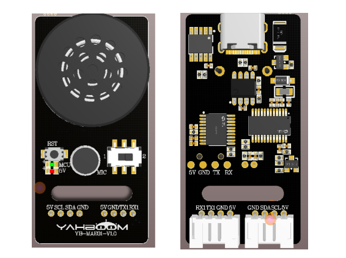

## **语音交互模块技术参数**

| 产品尺寸         | 48.1 * 24.1* 14.3mm | 产品重量              | 10g          |
| ---------------- | ------------------- | --------------------- | ------------ |
| **语音芯片型号** | **CI1302**          | **IIC接口、串口接口** | **1 个**     |
| **Type-C串口**   | **1个**             | **工作电压**          | **5V**       |
| **CPU主频**      | **可达 220MHz**     | **RAM容量**           | **640KByte** |
| **FLASH容量**    | **2MByte**          | **工作温度**          | **常温**     |

